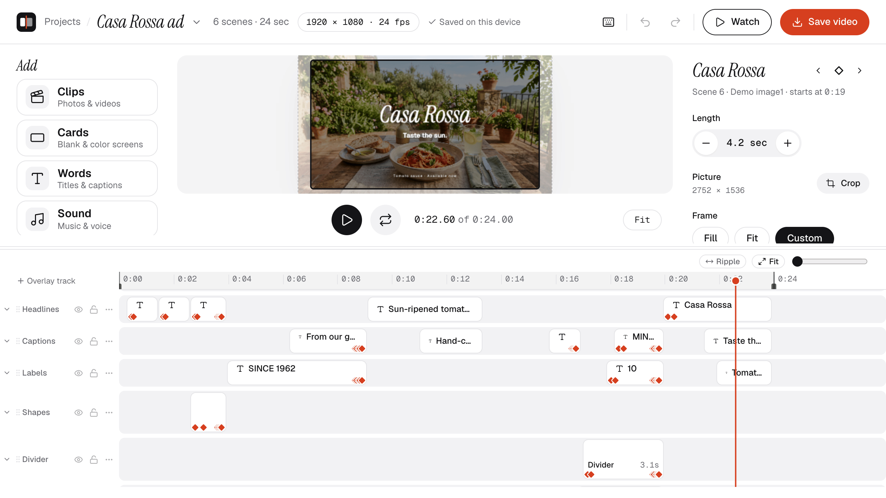
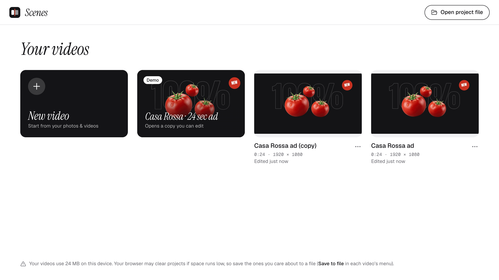

# Scenes

Video editing as easy as arranging photos. Runs in your browser, nothing uploaded.



Scenes is an easy video editor in the browser, made for people who've never edited a video. You
build a video as a storyboard of scenes, one after another, instead of working on a complicated
timeline. Text, layers, animation and music go on tracks above and below it when you want them.

## Features

### Editing

- A storyboard of scenes from your videos and photos: drag to reorder, trim either end, split at
  the playhead, duplicate
- Cards: plain colour screens, with an optional shape
- Crop, and framing: fill the frame, fit inside it, or place and zoom the picture yourself
- Speed (0.5×, 1×, 2×) and six colour moods, such as Golden and B & W
- Transitions between scenes: cut, crossfade, fade to black, slide and zoom
- Any shape of video (landscape, vertical, square and more) at 24, 25, 30 or 60 fps
- Undo and redo for everything, a range for playing and saving just part of the video, and a
  full-screen Watch mode

### Layers and text

- As many overlay tracks as you need, for videos, photos (transparent PNGs too), cards and words;
  up to four videos can play over the scenes at once
- Layers with rounded corners, borders, shadows and opacity, placed and sized on the picture
- Words in six styles (from Clean white to Highlighter and Big title), built-in fonts or your
  own, any colour, with outlines, boxes and shadows
- Entrance animations for words and layers: fade, slide up and pop

### Animation

- Keyframes for position, scale (linked or not), rotation and opacity, on layers and words
- Easing for each keyframe: linear, ease in and out, hold, overshoot and bounce
- Animated framing on scenes, for slow Ken Burns-style zooms and pans

### Sound

- Music and voiceover tracks: add songs, or record a voiceover with your microphone
- Trimming, fade in and out, and volume points to duck the music under the voice
- Each video clip's own sound, with its own volume

### Export

- MP4 video with sound
- GIF or animated WebP
- Audio only: WAV, M4A or MP3
- The current frame as PNG or JPG
- Overlays only, with transparency: WebM, or PNG frames in a ZIP
- The whole video, or just a range

### Projects

- Saved automatically on your device, as you work
- As many projects as you like, from a home screen with renaming, duplicating and deleting
- Save a project to a `.scenes` file with all its media, and open it again on any computer
- A built-in demo, "Casa Rossa", to open and take apart

## Private by design

Everything happens in your browser. Videos are decoded and encoded with WebCodecs, the picture
is drawn with WebGL, and sound is mixed with Web Audio, all on your own device. Your media and
projects are stored in the browser (IndexedDB), and nothing is uploaded to a server.

## Built with

Svelte 5, SvelteKit, TypeScript, WebCodecs (via Mediabunny), WebGL2, Web Audio, IndexedDB,
Vitest and Playwright.

## Run it locally

You need [Node.js](https://nodejs.org) 23 or newer (the demo build script runs TypeScript
directly) and Google Chrome (for the end-to-end tests).

```sh
npm install
npm run dev
```

Then open the address it prints (usually http://localhost:5173).

## Tests

```sh
npm run check      # type check
npm run lint       # formatting and lint
npm test           # unit tests (Vitest)
npm run test:e2e   # end-to-end tests in Chrome (Playwright; builds and serves the app itself)
```

## Build

```sh
npm run build      # a static site in build/
npm run preview    # serve that build locally
```

## The demo project

The home screen has a demo, "Casa Rossa", a short ad made with the app. To regenerate it from
the files in `demo-assets/`:

```sh
node scripts/build-demo.ts              # add --no-export to skip the MP4 and review frames
```

It writes `static/demo/casa-rossa.scenes` and its picture, plus an exported MP4 and review frames
in `demo-review/` (not committed). It needs `ffmpeg` installed.

The demo assets (music, video and images in `demo-assets/`) are for the built-in demo only.

## Screenshots

```sh
npm run screenshots
```

Regenerates `docs/screenshots/editor.png` and `home.png` (2560 × 1440, in a fresh browser profile,
compressed with `ffmpeg`), e.g. after a design change.



## More

`NOTES.md` has the architecture, the decisions made along the way, and what each change did.
